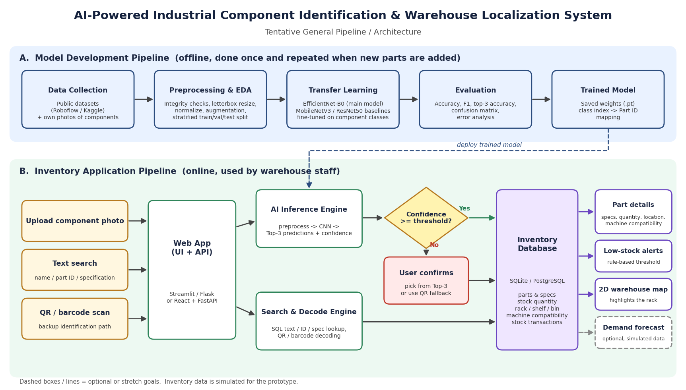

# SUDARSHAN

**AI-Powered Industrial Component Identification, Inventory Digitization and Warehouse Localization System**

Upload a photo of a machine part and the system identifies the part type with a confidence score, then shows its available sizes, stock quantity, warehouse location (zone / rack / shelf / bin) and compatible machines. Parts can also be searched by name, ID or specification.

**Team:** Srishti Trivedi, Lavaniya Bhardwaj
**UN SDG:** SDG 9 (Industry, Innovation and Infrastructure), SDG 12 (Responsible Consumption and Production)

## Architecture



## Features

- **Image-based identification:** EfficientNet-B0 (transfer learning) returns the top-3 predictions with confidence scores
- **Confidence-based decision:** predictions above a threshold are accepted automatically; low-confidence ones ask the user to confirm from the top 3
- **Search:** by part name, part ID, specification, material, machine or part type
- **Inventory:** stock quantity, rack / shelf / bin location, machine compatibility, stock updates
- **Low-stock alerts:** rule-based (quantity below minimum stock)
- **2D warehouse map:** highlights the rack that holds the selected part

## Dataset

[screwdetectclassification (Roboflow Universe)](https://universe.roboflow.com/roboflow100vl-full/screwdetectclassification-xrrbi-gdsj), MIT license. It has 5 fastener classes: Hex Washer Screw, Hexagonal Bolt, Philips Screw, Pozidriv Screw and Torx Screw.

The dataset is multi-label (one photo can contain several screw types). We kept only the **238 photos that contain exactly one screw type**, pooled the original splits, and re-split them 70 / 15 / 15 stratified by class, keeping copies of the same photo together to avoid leakage.

| Class | Train | Val | Test |
|---|---|---|---|
| Hex Washer Screw | 11 | 1 | 3 |
| Hexagonal Bolt | 18 | 4 | 3 |
| Philips Screw | 48 | 8 | 9 |
| Pozidriv Screw | 6 | 2 | 1 |
| Torx Screw | 87 | 19 | 18 |
| **Total** | **170** | **34** | **34** |

The images are not stored in this repository. Download the dataset from the link above (COCO format zip) to reproduce training; the preprocessing code is in `notebooks/`.

## Model and results

- **Preprocessing:** integrity and duplicate checks, letterbox resize to 224x224 (keeps part proportions), ImageNet normalization
- **Augmentation:** rotation, flip, scale/shift, brightness/contrast, blur, noise (no hue changes, because colour indicates material)
- **Model:** EfficientNet-B0 pre-trained on ImageNet, new classification layer for 5 classes
- **Training (Google Colab T4):** stage 1 trains only the new head (5 epochs), stage 2 fine-tunes the whole network (15 epochs, lower learning rate); class-weighted cross-entropy to handle imbalance

| Metric (test set, 34 images) | Value |
|---|---|
| Accuracy | 1.000 |
| Macro F1 | 1.000 |
| Top-3 accuracy | 1.000 |

**Important:** the test set is very small (Pozidriv has 1 test image, Hex Washer Screw and Hexagonal Bolt have 3 each) and comes from the same clean capture setup as the training data. These results show that the pipeline works; they are not a guarantee of real-world accuracy.

## Project structure

```
SUDARSHAN/
├── app/app.py              # Streamlit web app
├── database/make_db.py     # creates the simulated inventory database
├── models/                 # trained model (best_model.pt), class mapping, metrics
├── notebooks/              # preprocessing, EDA and training notebook (Google Colab)
├── architecture_diagram.png
└── requirements.txt
```

## How to run

Tested with Python 3.14 on Windows (streamlit 1.67, torch 2.15, torchvision 0.29).

```bash
git clone https://github.com/trivedisrishti0999/SUDARSHAN.git
cd SUDARSHAN
pip install -r requirements.txt
python database/make_db.py
streamlit run app/app.py
```

On Windows you can use `py -m pip ...`, `py database\make_db.py` and `py -m streamlit run app\app.py`.

## Limitations

- Small dataset (238 images, 5 classes) and a small test set
- The model identifies the **type** of part, not its size; the user chooses the exact size from the variants list
- It is a closed-set classifier: any image gets one of the 5 labels, so the confidence threshold is used to flag uncertain predictions
- Inventory data (quantities, locations, machines) is simulated
- Trained on clean, plain-background photos

## Future work

- Compare with MobileNetV3 and ResNet50
- Test and fine-tune on our own phone photos
- Multi-part detection (YOLO), since many photos contain several screw types
- QR / barcode lookup as a backup identification path
- Demand forecasting on consumption data
- A larger, more varied dataset including bearings, gears and electrical parts
